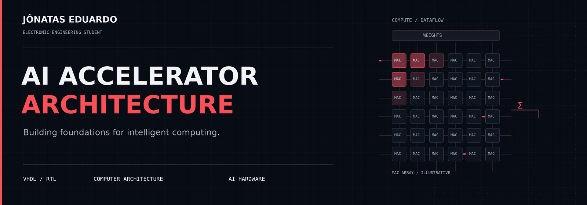

  

  

  <b>Applied AI · Digital Hardware · Computer Architecture</b> 
  🎯 Career focus: <b>AI Accelerator Architecture</b> 
  📍 Rio de Janeiro, Brazil

---

### 👋 About me

**From AI systems to the hardware that powers them.**

I'm **Jônatas Eduardo**, an Electronic Engineering student at **UFCIRJ** and an Electronics Technician. My background combines **applied AI projects, Python development and technical leadership through IEEE**.

Since joining IEEE in 2024, I've worked on projects involving **generative AI, natural language processing, retrieval-augmented generation, multi-agent systems and computer vision**. That experience shapes my interest in how intelligent systems are built and how their computational demands translate into hardware.

My career focus is **AI Accelerator Architecture**: connecting AI workloads with digital design, parallel computation, memory systems and hardware–software co-design.

### 🧠 Applied AI experience

Through technical projects at the **IEEE CEFET/RJ Student Branch**, I've contributed to:

| Project / area | Technical work |
| :--- | :--- |
| 🤖 **AVIR · Generative AI & NLP** | Development of a virtual assistant using language models and **RAG** to retrieve information from IEEE documents and support access to internal knowledge and processes. |
| 🔗 **Multi-agent automation** | Development of AI-based automation with **Python and multi-agent systems**, supporting internal workflows and reducing repetitive tasks. |
| ⚽ **Robot soccer · Computer vision** | Work on **YOLOv8-based computer vision** for a robot soccer project, connecting visual perception with robotics and hardware–software integration. |

  <kbd>Python</kbd> &nbsp; <kbd>Generative AI</kbd> &nbsp; <kbd>LLMs</kbd> &nbsp; <kbd>RAG</kbd> &nbsp; <kbd>NLP</kbd>  
  <kbd>Multi-agent Systems</kbd> &nbsp; <kbd>Computer Vision</kbd> &nbsp; <kbd>YOLOv8</kbd>

---

<h3> Connecting AI and hardware</h3>

Working on AI systems motivates me to understand the architecture beneath their execution: how matrix operations map to compute units, how memory bandwidth limits performance, and how data reuse and numerical precision affect efficiency.

My hardware background includes **academic experience with VHDL and FPGA**. I'm extending that work toward **RTL design, processor microarchitecture and AI accelerators**, with particular interest in:

| Focus | Engineering interests |
| :--- | :--- |
| ⚙️ **Compute** | MAC units, matrix multiplication, parallel datapaths and systolic arrays. |
| 💾 **Data movement** | Memory hierarchies, dataflow, bandwidth and data reuse. |
| 🧮 **AI workloads** | Neural-network inference, quantization and hardware–software co-design. |
| 📐 **Architecture trade-offs** | Performance, power, area, latency and throughput. |

  <kbd>VHDL</kbd> &nbsp; <kbd>FPGA</kbd> &nbsp; <kbd>RTL</kbd> &nbsp; <kbd>Computer Architecture</kbd>

---

### 🌐 IEEE leadership & community

Alongside technical projects, I've led teams and initiatives connecting students, researchers and industry:

| Role | Scope & results |
| :--- | :--- |
| **Chair · IEEE Computer Society Student Chapter, CEFET/RJ** 2025–2026 | Led a community of **90+ participants**; official memberships grew from **17 to 34**. |
| **Event Operations Coordinator · IEEE AI Pioneer Summit** 2025 | Coordinated **19 volunteers** across operations, registration, communication and speaker support. |
| **General Coordinator · IEEE Computer Society Brazil Symposium** 2026 | **223 registrations · 188 participants · 21 institutions** represented. |

### ☕ Beyond engineering

🎲 I enjoy **tabletop role-playing games** and ✍️ **writing fiction**. 🎧 I'm also a **big hip-hop fan**.

---

   
  AI workloads. Digital systems. Accelerator architecture.

